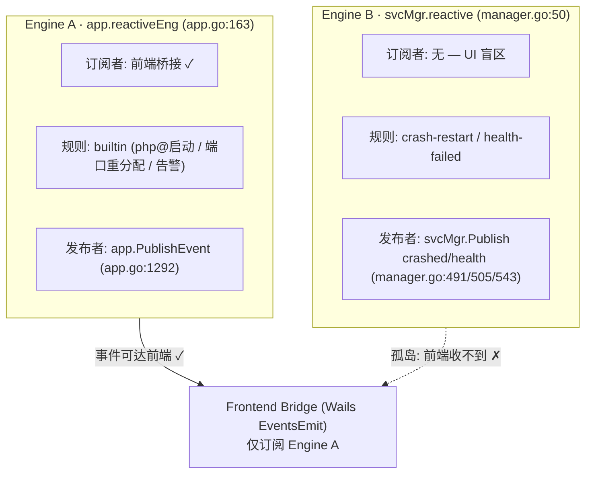

# DevStack 代码问题诊断报告

> 审查范围：Go 后端（Wails v2 + 自研多域管理器）+ Svelte 前端
> 审查日期：2026-08-07
> 定位方式：静态阅读源码，所有结论均附文件:行号
> 严重程度分级：P0 = 正确性/稳定性缺陷（建议立即修复）；P1 = 设计/正确性隐患；P2 = 技术债务

---

## 概览

| 编号 | 问题 | 级别 | 核心位置 |
|------|------|------|----------|
| P0-1 | 双 reactive 引擎导致事件孤岛 | P0 | app.go:163 / service/manager.go:50 |
| P0-2 | `Stop` 持全局锁最长阻塞约 3 秒 | P0 | service/manager.go:393-459 |
| P0-3 | `Start` 并发启动无防护 | P0 | service/manager.go:319-391 |
| P0-4 | `dispatch` 裸 goroutine 无 panic recovery | P0 | reactive/engine.go:78-81 |
| P0-5 | 生产构建仍弹 DevTools | P0 | main.go:66-68 |
| P1-1 | `app.go` 是 1392 行 God Object | P1 | app.go |
| P1-2 | 下载逻辑重复且存在死代码 | P1 | app.go:645 / app.go:1136 |
| P1-3 | `getActiveEnvironmentID` 静默吞错 + 绕过 StateStore | P1 | app.go:451-464 |
| P1-4 | `Configure` 事务与锁边界脆弱 | P1 | service/manager.go:676-724 |
| P2-1 | 前端依赖栈严重过时 | P2 | frontend/package.json |
| P2-2 | README 仍为模板残留 | P2 | README.md |
| P2-3 | 核心模块缺单测（并发缺陷在盲区） | P2 | internal/service, internal/engine, internal/process |
| P2-4 | 子进程输出被丢弃 | P2 | process/process.go:56-57 |
| P2-5 | `GetLogs` 覆盖不全 | P2 | app.go:1314-1343 |

---

# P0 — 正确性 / 稳定性缺陷

## P0-1 双 reactive 引擎导致事件孤岛

### 现象
代码里存在**两个完全独立的 `reactive.Engine` 实例**，各自拥有独立的内存订阅表、规则集与事件缓冲。`reactive.Engine` 的订阅表是实例私有的（`engine.go:13` 的 `subscribers map`），`Publish` 只把事件塞进自己那个 `eventBuffer`（`engine.go:89-105`），两个实例之间没有任何桥接。

### 关键事实与代码定位
- **Engine A（`reactiveEng`）**：由 `app.NewApp` 在 `app.go:163` 创建（`reactive.NewEngine(100)`），`app.go:189` 启动。
- **Engine B（`m.reactive`）**：由 `service.NewManager` 在 `manager.go:50` 创建，并自带 `m.reactive.Start()`（`manager.go:52`）。
- **谁在往哪个引擎发事件**（全仓 `Publish` 调用已逐一确认）：

| 事件 | 发布位置 | 目标引擎 |
|------|----------|----------|
| `service.crashed` | `manager.go:491 / 543` | **Engine B** |
| `service.health-failed` | `manager.go:505` | **Engine B** |
| 通用/自定义事件 | `app.go:1292`（`app.PublishEvent`） | **Engine A** |
| `service.started / stopped / restarted` | 生产代码**零发布**（仅 `engine_test.go` 出现） | —（死订阅） |

- Engine B 上挂的两条崩溃自愈规则（`registerReactiveRules`，`manager.go:58-88`）正是核心：`service-crash-restart` 收到 `crashed` 后自动 `m.Start(id)` 重启；`service-health-failed` 收到 `health-failed` 后调 `publishCrashEvent` 再发 `crashed`。

### 断点
前端事件桥接在 `app.startup` 注册（`app.go:267-298`），遍历的那串事件类型（含 `EventServiceCrashed`、`EventServiceHealthFailed`、`EventServiceRestarted` 等）**全部 `Subscribe` 在 `a.reactiveEng`（Engine A）上**，再经 `wailsruntime.EventsEmit` 推给前端。而崩溃/健康检查事件只发到 Engine B，Engine B **没有任何订阅者通向 UI**。



### 连带损伤
- 服务崩溃 → Engine B 触发 `service-crash-restart` → 后端静默重启，**前端完全无感知**（无崩溃提示、无重启状态、状态图标不闪）。
- 健康检查失败 → Engine B 触发 `service-health-failed` → 再发 `crashed` → 同样对前端不可见。
- 规则集被割裂：Engine A 的 builtin 规则与 Engine B 的崩溃规则永远看不到对方的事件。
- 资源浪费：两个引擎各自跑一个 `processEvents` goroutine、各持一个缓冲与规则执行循环（`engine.go:48-87`），双倍事件基础设施却零互通。
- 死订阅：前端还订阅了 `service.started/stopped/restarted`（`app.go:270-271, 274`），但生产代码从未发布这三类事件，订阅形同虚设。

### 根因
`service.Manager` 在构造函数里自产自销一个引擎（`manager.go:50`），未通过依赖注入复用上层已创建的实例；`app.NewApp` 又新建另一个。两者从未统一。

### 修复方向
1. 合并为单一引擎：在 `NewApp` 创建 `reactiveEng` 后，注入 `service.NewManager(cfg, procMgr, resMgr, reactiveEng)`，去掉 `manager.go:50` 的 `reactive.NewEngine` 与 `:52` 的 `Start`；`RegisterBuiltinRules` 也复用同一实例。
2. 统一 `Publish` 目标：`manager.go` 三处 `m.reactive.Publish` 改为复用共享引擎。
3. 在 `svcMgr.Start/Stop` 成功路径上 `Publish` `EventServiceStarted/Stopped/Restarted`，让前端订阅真正生效。
4. 配合 P0-4 给 `dispatch` 加 `recover`。

---

## P0-2 `Stop` 持全局锁最长阻塞约 3 秒

### 现象
`service.Manager.Stop` 在**持有 `m.mu` 全局锁**的情况下，同步执行外部 `entity.Stop()` 并做最多 6×500ms 的端口轮询。期间所有依赖该锁的 API 全部冻结。

### 关键事实与代码定位
- `manager.go:394` `m.mu.Lock()` 持锁起点。
- `manager.go:425` `entity.Stop(context.Background())` 为**同步阻塞**调用，外部进程停止耗时不可控。
- `manager.go:438-452` 兜底轮询：端口仍占用时 `for j := 0; j < 6; j++ { time.Sleep(500ms); ... }`，最坏 **3 秒**卡在锁内。
- `manager.go:457` `m.mu.Unlock()` 持锁终点——上面这些全部发生在这之间。
- 对比 `Start`：它在 `manager.go:336` 就 `m.mu.Unlock()`，把外部 `NewInstance`/`Start` 放到锁外执行；二者防护策略不一致。

### 影响
停用或删除任一服务时，整个面板（依赖 `m.mu` 的 `List`/`Start`/`Get`/`Configure`）会被冻结最多约 3 秒，表现为界面卡死、操作无响应。

### 根因
把"对外部进程的慢操作 + 轮询等待"错误地放进临界区，而非像 `Start` 那样先释放锁再执行。

### 修复方向
将 `entity.Stop()` 与端口轮询移到 `m.mu.Unlock()` 之后执行；如需在停止完成后再改状态，用局部变量暂存结果，最后仅在更新 `s.Info.Status`/`s.process` 等共享字段时短暂加锁。

---

## P0-3 `Start` 并发启动无防护

### 现象
对同一个服务的两次并发 `Start` 调用，会各自拉起一个进程，导致双进程、状态互相覆盖。

### 关键事实与代码定位
- `manager.go:319` `Start` 入口加锁（`m.mu.Lock()`）。
- `manager.go:327` 仅拦截 `s.Info.Status == core.StatusRunning`：已运行则直接返回。
- `manager.go:335` 置为 `StatusStarting`，`manager.go:336` 立即 `m.mu.Unlock()`。
- 此后在锁外执行 `provider.Get` → `NewInstance`（`manager.go:347`）→ `entity.Start`（`manager.go:356`）。
- 第二个并发 `Start` 看到状态是 `Starting`（不是 `Running`），**绕过 327 的拦截**，再次置 `Starting`、解锁、再次 `NewInstance`+`Start`，并在 `manager.go:388` 再起一个 `watchProcess` goroutine。

### 影响
同一服务可能出现两个进程监听同一端口（`entity.Start` 或端口分配阶段冲突），`s.Info.PID`/`s.process` 被后者覆盖，前一个进程成为游离的"幽灵进程"，自愈逻辑也会基于错误的 PID 判断。

### 根因
并发门只覆盖了稳态（`Running`），没有覆盖转换态（`Starting`/`Stopping`）。

### 修复方向
在 `manager.go:327` 把守卫扩展为 `if s.Info.Status == StatusRunning || s.Info.Status == StatusStarting { return nil/errAlreadyStarting }`；或更稳妥地引入 `(id -> startInFlight)` 的正在进行的启动集合，进入启动流程即登记，完成或失败才清除。

---

## P0-4 `dispatch` 裸 goroutine 无 panic recovery

### 现象
事件引擎每派发一个 handler 就 `go handler(event)`，无 `defer recover`。任一订阅函数 panic 会直接 crash 整个进程。

### 关键事实与代码定位
- `engine.go:78-81`：
  ```go
  for _, handler := range handlers {
      go handler(event)
  }
  ```
- 同文件 `engine.go:83-87` `executeRules` 与 `engine.go:102` `onDropped` 回调也是裸 `go`，同样无 recover。

### 影响
前端桥接 handler（`app.go:287`）里若因异常 `ctx`、`event.Data` 形态不符等发生 panic，进程直接退出，所有服务管理功能集体失效——且崩溃发生在事件回调里，堆栈难以定位。

### 根因
把 goroutine 的容错责任推给了每个 handler，而框架层未提供统一兜底。

### 修复方向
在 `dispatch`/`executeRules`/`onDropped` 的 goroutine 入口加 `defer func(){ if r := recover(); r != nil { 记录 } }()`；并在 `reactive` 包提供测试验证单个 handler panic 不影响引擎继续运转。

---

## P0-5 生产构建仍弹 DevTools

### 现象
`wails build` 产出的发布版本启动即弹出 Webview 开发者工具。

### 关键事实与代码定位
- `main.go:66-68`：
  ```go
  Debug: options.Debug{
      OpenInspectorOnStartup: true,
  },
  ```
- 该配置**无条件生效**，未区分 `wails dev` 与 `wails build`。

### 影响
发布版本每次启动弹出调试器，既干扰正常使用、暴露内部接口，也让普通用户困惑。

### 根因
调试开关硬编码为 `true`，缺少按构建模式（dev/build）或环境变量门控。

### 修复方向
仅在 dev 模式启用，例如读取 `wails.IsDevMode()` 或环境变量：`OpenInspectorOnStartup: wails.IsDevMode()`；或在 `wails.json` 的 build 配置里显式关闭。

---

# P1 — 设计 / 正确性隐患

## P1-1 `app.go` 是 1392 行 God Object

### 现象
所有领域 API（环境、服务、项目、下载、日志、系统、MySQL 等）堆在单个 `app.go`（经 `wc -l` 实测 **1392 行**）里，违反单一职责。

### 关键事实与代码定位
- 文件 `G:\DevStack\app.go` 共 1392 行，从 `NewApp` 到各类 `XxxAPI` 方法全部集中。
- 仅 API 分组注释就包括 Environment / Service / Project / Download / MySQL / System / Logs 等多个域。

### 影响
- 改动任意一处都需在巨型文件中定位，合并冲突概率高。
- 难以针对单域做单元测试与复用。
- 与 P0-1 的引擎、P1-2 的下载重复等问题耦合，放大维护成本。

### 根因
项目成长过程中未做按域拆分，累积成单体文件。

### 修复方向
按域拆分为 `environment_api.go` / `service_api.go` / `project_api.go` / `download_api.go` / `log_api.go` 等，文件顶部保留结构体定义与 `NewApp`。拆分是机械性重构，可逐步进行并保留 `app.go` 作为组合点。

---

## P1-2 下载逻辑重复且存在死代码

### 现象
两处几乎相同的下载实现：`downloadServiceVersion`（`app.go:645`）与 `DownloadService`（`app.go:1136`）。经全仓 grep 确认，`downloadServiceVersion` **仅被定义、从未被任何代码调用**——是死代码。

### 关键事实与代码定位
- `app.go:645` `downloadServiceVersion(kind, version string)`：取版本列表 → 拼 URL → `TryDownloadAndExtract`。
- `app.go:1136` `DownloadService(serviceType, version, url)`：逻辑高度重复，且通过 `Bind` 暴露给前端，是**实际在用**的入口。
- grep `downloadServiceVersion` 仅命中 `app.go:644-645`（定义处），无调用点。

### 影响
- 维护时需同步两处，易漂移。
- 死代码增加阅读噪音，且可能让人误以为存在另一条下载路径（例如 Configure 走 `kind@version` 的下载）。

### 根因
下载能力早期写在 `app` 层且未收敛到 `download.Manager`，重构时遗留未删除的副本。

### 修复方向
删除 `downloadServiceVersion` 死代码；若确有按 `kind@version` 触发的下载需求，统一收敛到 `DownloadService` 或 `download.Manager` 的单一方法，避免重复。

---

## P1-3 `getActiveEnvironmentID` 静默吞错 + 绕过 StateStore

### 现象
读取当前激活环境 ID 时，文件读错误被吞掉、JSON 解析错误被忽略，且直接 `os.ReadFile` 绕过 `StateStore` 抽象。

### 关键事实与代码定位
- `app.go:451-464`：
  ```go
  data, err := os.ReadFile(path)
  if err != nil {
      return "", nil          // 读文件失败 → 静默返回空，不报错
  }
  json.Unmarshal(data, &s)    // 错误被完全忽略
  return s.ActiveEnvironmentID, nil
  ```
- 落盘路径 `config/environment.json` 与 `engine.StateStore.SaveActive`（reconciler 激活时写入）一致，但此处**绕过**了 `StateStore` 封装直接读文件。

### 影响
- 环境文件损坏/权限异常时，调用方拿到空 ID 而非错误，后续逻辑可能在"无激活环境"的错误假设下运行，难以排查。
- 直接读文件破坏了状态层的封装边界，未来若 `StateStore` 换存储（内存/加密/DB）此处会失效。

### 根因
用一次性文件读取代替领域状态接口，且对错误采取"返回零值"的惰性处理。

### 修复方向
改为调用 `stateStore.GetActive()` 之类接口；若必须保留独立读取，至少把 `ReadFile`/`Unmarshal` 的错误向上返回，让调用方知道"无环境"与"读取出错"的区别。

---

## P1-4 `Configure` 事务与锁边界脆弱

### 现象
`Configure` 在释放主锁后执行事务，而事务内的 `apply-config` 步骤又重新加同一把 `m.mu` 锁，形成嵌套/重入式锁边界，且补偿逻辑无任何测试覆盖。

### 关键事实与代码定位
- `manager.go:676-724`：
  - `:677` `m.mu.Lock()`，`:699` `m.mu.Unlock()`（事务构建在锁外）。
  - `:708-716` 事务两步：`backup-config`（`copyDir`）、`apply-config`（内部 `m.mu.Lock(); defer m.mu.Unlock()` 再调 `handler.Configure`）。
  - `:718` `txn.Commit()` 在调用方 goroutine 同步执行，触发步骤。
  - 补偿 `compensator.RestoreBackup(backupPath, configPath)` 负责回滚。
- 实际当前不会死锁（`:699` 已解锁），但**步骤函数重入 `m.mu`** 的写法极其脆弱：一旦将来有人在持有 `m.mu` 的上下文中调用 `Configure`，立即自死锁。

### 影响
- 配置写入的并发安全性依赖"调用方此刻不能持锁"这一未文档化的隐式契约。
- 备份→应用→补偿全链路无单元测试，真出问题时回滚是否干净未知。

### 根因
把"事务步骤"与"共享锁"混在同一方法内，且没有把临界区收缩到仅更新共享字段的最小范围。

### 修复方向
明确 `Configure` 不假设调用方持锁；将 `apply-config` 步骤内的锁改为仅保护 `m.services[id]` 这类共享结构的短暂读写；为备份/应用/补偿编写单测，覆盖"应用失败能还原到备份"的路径。

---

# P2 — 技术债务

## P2-1 前端依赖栈严重过时

### 现象
前端锁定在 Vite 3 / Svelte 3 / @sveltejs/vite-plugin-svelte 1 / TypeScript ^7 这一代，落后当前主流两个大版本。

### 关键事实与代码定位
- `frontend/package.json`：`vite ^3.0.7`、`svelte ^3.49.0`、`@sveltejs/vite-plugin-svelte ^1.0.1`、`typescript ^7.0.2`。
- `node_modules` 实际解析为 vite 3.2.x、svelte 3.x（与 peer 依赖一致）。

### 影响
- 当前 `frontend/dist` 存在说明曾经构建成功；但一旦 lock 丢失或需升级，将与 Vite 5/6、Svelte 4/5、plugin 3+ 生态严重不兼容，升级成本高、风险大。
- `typescript ^7.0.2` 是异常版本区间（TS 7 未作为稳定线存在），存在误配或后续解析意外。

### 修复方向
制定分阶段升级：先 Vite 3→5（含 plugin 1→3），再评估 Svelte 3→4/5（注意 Svelte 5 引入 runes 的破坏性变更）；升级前先补 P2-3 的前端测试与构建校验。

---

## P2-2 README 仍为模板残留

### 现象
`README.md` 仍是 Wails Svelte 模板的默认内容，无 DevStack 的功能、架构、构建/运行说明。

### 关键事实与代码定位
- 项目根 `README.md` 内容为 Wails 脚手架默认文本。

### 影响
新接手者无法从 README 了解项目是什么、怎么构建、架构如何，增加上手成本。

### 修复方向
补写：项目定位、技术栈、目录结构、构建与运行命令（`wails build` / `wails dev`）、核心模块职责、已知问题索引（指向本文档）。

---

## P2-3 核心模块缺单测（并发缺陷在盲区）

### 现象
存在并发/锁逻辑的核心模块 `service.Manager`、`engine.Reconciler`、`process.Manager` **均无任何单元测试**，而 P0-2/P0-3 的并发缺陷正落在这些盲区。

### 关键事实与代码定位
- 现有测试文件：`internal/log/clear_test.go`、`internal/engine/state_store_test.go`、`internal/environment/manager_test.go`、`internal/provider/nginx_provider_test.go`、`internal/reactive/engine_test.go`。
- **缺失**测试：`internal/service/manager_test.go`、`internal/engine/reconciler_test.go`、`internal/process/process_test.go`。
- 根 `app_test.go` 是 E2E 组装级（用 fake provider），覆盖不到 `Start`/`Stop` 的锁与并发细节。

### 影响
- 最危险的正确性缺陷（P0-2 持锁阻塞、P0-3 并发双启动）没有任何自动化防护，回归极易被忽略。
- 重构（P1-1 拆分、P1-4 锁整理）缺乏安全网。

### 修复方向
优先为 `service.Manager` 补单测：用 fake provider 验证 (a) 并发 `Start` 不会双进程；(b) `Stop` 不长期持锁；(c) 崩溃自愈规则触发重启。再补 `reconciler` 与 `process` 的基础用例。

---

## P2-4 子进程输出被丢弃

### 现象
统一进程管理在启动时把 `cmd.Stdout`/`cmd.Stderr` 置为 `nil`，子进程标准输出/错误无统一采集。

### 关键事实与代码定位
- `process/process.go:56-57`：`cmd.Stdout = nil; cmd.Stderr = nil`。

### 影响
- 服务进程自身打印的启动日志、运行时报错丢失，问题排查只能依赖各服务专有日志文件（且见 P2-5，node/python 还没有）。
- 与 P0 事件总线缺乏"进程 stderr → 告警"的联动，可观测性弱。

### 修复方向
将输出重定向到带缓冲的 `io.Writer`（或写入统一日志目录 + 环形缓冲），并可选地经 `reactive.Engine` 转发 `stderr` 行作为告警事件。

---

## P2-5 `GetLogs` 覆盖不全

### 现象
`GetLogs` 仅处理 nginx / mysql / redis@ / php@ 四类，node / python 服务无日志返回。

### 关键事实与代码定位
- `app.go:1314-1343`：`if serviceID == "nginx" {...} else if "mysql" {...} else if HasPrefix "redis@" {...} else if HasPrefix "php@" {...}`，其余分支 `logPath == ""` 返回空切片。

### 影响
- 用户在面板打开 node/python 服务的日志面板时看到空白，误以为无日志或功能损坏。
- 与项目系统支持 Node/Python 运行时的定位不一致（见 `app.go` 中 `python`/`node` 单元的环境编排）。

### 修复方向
补齐 node/python 的日志路径映射（与安装目录约定一致），或改为基于 `ServiceInfo` 的 `LogPath` 字段查表，避免硬编码 `if/else` 链。

---

# 修复优先级建议

1. **先解决 P0 全部 5 项**：事件孤岛（P0-1）、Stop 持锁（P0-2）、Start 并发（P0-3）、dispatch recover（P0-4）、关调试器（P0-5）。其中 P0-1 与 P0-4 可一并处理（合并引擎时统一加 recover）。
2. **再处理 P1**：优先拆分 `app.go`（P1-1）与删除死代码（P1-2），随后收敛 `getActiveEnvironmentID`（P1-3）与 `Configure` 锁边界（P1-4）。
3. **最后清偿 P2**：以 P2-3（补 `service.Manager` 单测）为底座，再推进依赖升级（P2-1）、文档（P2-2）、可观测性（P2-4、P2-5）。

> 说明：本文档的问题清单与行号基于 2026-08-07 的代码快照。重构后行号会偏移，建议以函数名/符号作为长期锚点。

---

# 复查结论（2026-08-07 第二轮）

> 方法：对每一项"特征代码"做 grep / 精读核实，不依赖声明。锚点以函数名/符号为准（行号为复查时快照）。

## 逐项状态

| 编号 | 问题 | 状态 | 复查证据 |
|------|------|------|----------|
| P0-1 | 双 reactive 引擎事件孤岛 | ✅ 已修复 | `app.go:124` 单点 `reactive.NewEngine(100)`；`:128` 注入 `service.NewManager(..., reactiveEng)`；`manager.go:43` 形参 `reactiveEng *reactive.Engine`；前端桥接 `app.go:286` 订阅同一引擎。崩溃/健康检查事件现经共享引擎到达前端。 |
| P0-2 | `Stop` 持全局锁阻塞 | ✅ 已修复 | `manager.go:415` 在外部 `entity.Stop` 与端口轮询（`:449` `time.Sleep`）之前 `m.mu.Unlock()`；状态更新在 `:460` 重新短暂加锁。睡眠已移至锁外。 |
| P0-3 | `Start` 并发无防护 | ✅ 已修复 | `manager.go:326` 守卫扩展为 `StatusRunning \|\| StatusStarting`，并发启动被拦在转换态。 |
| P0-4 | `dispatch` 无 panic recovery | ✅ 已修复 | `reactive/engine.go:81 / 93 / 116` 三处 goroutine 均含 `if r := recover(); r != nil {...}`（`dispatch`/`executeRules`/`onDropped`）。 |
| P0-5 | 生产构建弹 DevTools | ✅ 已修复 | `main.go:73` `OpenInspectorOnStartup: isDevMode()`，按构建模式门控。 |
| P1-1 | `app.go` God Object | ❌ 未修复 | `app.go` 仍 1351 行，无 `*_api.go` 拆分文件；仅因删死代码比首轮少 41 行。 |
| P1-2 | 下载逻辑重复 + 死代码 | ✅ 已修复 | `downloadServiceVersion` 已全仓移除（grep 无命中）；`DownloadService` 为唯一入口。 |
| P1-3 | `getActiveEnvironmentID` 吞错 | ✅ 已修复 | `app.go:450-456` 改为 `a.stateStore.Load()` 并 `return "", err`，不再吞错、不再绕封装直读文件。 |
| P1-4 | `Configure` 锁边界脆弱 | 🔶 改进（需复核） | `manager.go:722` `apply-config` 步骤由重入写锁改为 `m.mu.RLock()` 读取 `services[id]`。重入死锁风险消除，但若 `handler.Configure` 会写 `si.Info` 等共享字段，则存在并发写 race，需确认 handler 仅读。 |
| P2-1 | 前端依赖栈过时 | ❌ 未修复 | `frontend/package.json` 仍为 `vite ^3.0.7` / `svelte ^3.49.0` / `@sveltejs/vite-plugin-svelte ^1.0.1` / `typescript ^7.0.2`。仅新增 biome / tailwind / daisyui / nanostores 等工具链依赖，核心构建栈未升级。 |
| P2-2 | README 模板残留 | ✅ 已修复 | `README.md` 已改写为 DevStack 专属：功能特性、技术栈（Wails v2 + Go + Svelte）、目录结构等。 |
| P2-3 | 核心模块缺单测 | ❌ 未修复 | `internal/service`、`internal/engine`（reconciler）、`internal/process` 仍无 `*_test.go`；P0-2/P0-3 的并发修复**无自动化防护**。 |
| P2-4 | 子进程输出丢弃 | ✅ 已修复 | `process/process.go:106-110` 经 `io.Pipe` 将 `cmd.Stdout/Stderr` 接到 `ProcessOutput`，并提供 `GetOutput(pid)`。 |
| P2-5 | `GetLogs` 覆盖不全 | ✅ 已修复 | `app.go:1287 / 1290` 新增 `node@` / `python@` 分支。 |

## 统计
- 已修复：10 / 14
- 改进待复核：1（P1-4）
- 未修复：3（P1-1、P2-1、P2-3）

## 仍存风险与建议
1. **最高优先级补 P2-3**：P0-2/P0-3 的并发修复是手工改动，但 `service.Manager` 无任何单测守护。建议立即补 `manager_test.go`，用 fake provider 固化"并发 Start 不双进程""Stop 不长期持锁"两个不变量。
2. **P1-4 需确认**：核查各 `ConfigHandler.Configure` 实现是否仅读取 `si`、不写共享字段；若有写，应改回短写锁或把写操作移出临界区。
3. **P2-1 仍是技术债**：构建栈落后两个大版本，升级前务必先补 P2-3 的测试与 `typecheck`/`build` 校验（package.json 已备 `biome`/`tsc --noEmit` 脚本）。
4. **P1-1 可择机处理**：God Object 不影响正确性，建议作为独立重构，配合 P2-3 测试安全网进行。
